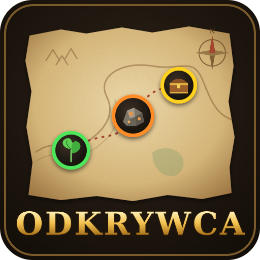

<p align="center"></p>

# Odkrywca

**World of Warcraft: Forever** addon (1.60.x, interface 16001).

🇵🇱 Zapisuje tylko te zioła, rudy i skrzynie, które **sam zebrałeś**, i pokazuje je na mapie świata. Bez gotowej bazy danych – mapa zapełnia się w miarę odkrywania świata, tak jak w dawnych czasach.

🇬🇧 Records only the herbs, ore veins and chests **you gathered yourself** and shows them on the world map. No pre-made database – your map fills up as you explore, just like the old days.

## Features / Funkcje

- Records herbs, ore and chests when you gather them / zapis ziół, rud i skrzyń przy zbieraniu
- Round pins coloured by type (green herbs, orange ore, gold chests) with the icon of what dropped
- Tooltip: times gathered, first/last discovery, total loot, which of your characters found it
- Zone pins are also shown on the continent map
- Filters, icon size, "this character only" mode
- Shift + right-click a pin to delete it
- Polish and English (`/odk lang en`, `/odk jezyk pl`)

## Installation / Instalacja

Copy the `Odkrywca` folder to:

```
World of Warcraft\_forever_\Interface\AddOns\
```

## Commands / Komendy

| PL | EN | |
|---|---|---|
| `/odk pokaz` | `/odk show` | toggle all pins |
| `/odk ziola` / `rudy` / `skrzynie` | `/odk herbs` / `ore` / `chests` | type filters |
| `/odk moje` | `/odk mine` | only this character's discoveries |
| `/odk rozmiar 18` | `/odk size 18` | icon size (8–40) |
| `/odk ogloszenia` | `/odk announce` | chat message on new discovery |
| `/odk stat` | `/odk stats` | statistics |
| `/odk wyczysc tak` | `/odk clear yes` | delete nodes in the current zone |
| `/odk reset tak` | `/odk reset yes` | delete all discoveries |
| `/odk jezyk en` | `/odk lang pl` | language |

## License

MIT
